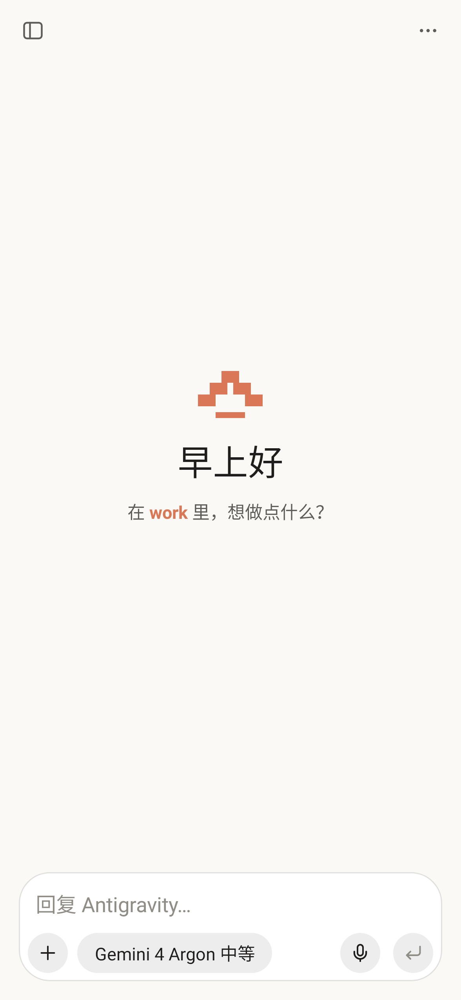
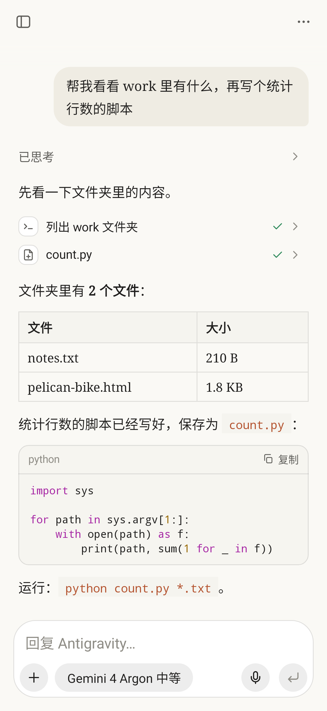
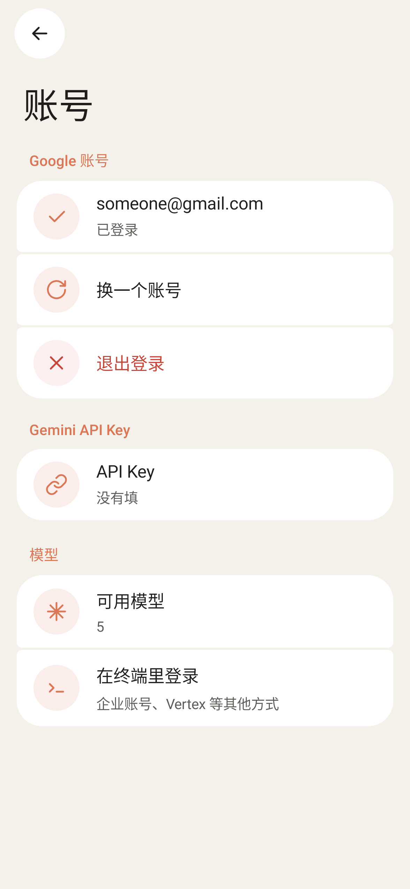
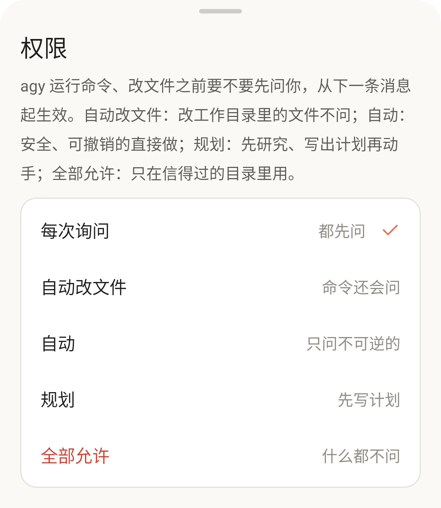

# Antigravity for Android

在 Android 手机上直接用 Google 的 [Antigravity CLI](https://antigravity.google/docs/cli/)（`agy`）的 App，不需要 Termux。

App 自带一个小型 Linux 环境（Alpine + Python + proot），`agy` 就跑在里面；界面是原生 Android 控件，不是 WebView，滚动和选字都是系统自己的。界面和交互沿用 [ClaudeCode-Android](https://github.com/Jeep-dev/ClaudeCode-Android) 和 [PiAgent-Android](https://github.com/Jeep-dev/PiAgent-Android)。

  
  
  
  

从左到右：新对话、对话、设置 → 账号、权限模式。截图由 <code>ScreensTest</code> 生成，内容是演示用的。

> 这是个人项目，不是 Google 的产品，和 Google 没有关系。`agy` 本身不在这个仓库里：第一次打开 App 时，从 Google 的官方地址下载 Linux 版，并按 Google 公布的 SHA-512 校验。使用 `agy` 需要遵守 Google 的条款。

## 功能

- **对话**：流式回复、思考过程、工具步骤（命令、文件改动和 diff、读文件、计划）都折叠成行；回复进行中可以继续发消息（插入：在模型执行工具时交给它；或者排队：等回复结束再发）。
- **权限**：`agy` 要运行命令、改文件时，在对应那一行点「允许」或「拒绝」。权限模式有：每次询问、自动改文件、自动、规划、全部允许，可以在模型菜单、`/mode` 或「设置 → 对话」里切换。
- **登录**：设置 → 账号 →「用 Google 登录」：在浏览器里登录，再把页面上的授权码粘贴回 App。也可以填 Gemini API Key。
- **模型**：输入框下方的模型按钮或 `/model`：列出 `agy` 提供的模型（Gemini、Claude、GPT-OSS 等），每个模型能用的思考级别各不相同。
- **对话列表**：侧边抽屉列出 `agy` 自己保存的对话，可以搜索、置顶、重命名、删除；在任意位置右滑就能打开。
- **用量**：右上角菜单里的「用量」，显示当前对话的上下文占用和已用的 token。
- **附件**：图片直接发给模型，其他文件存进工作目录。
- **斜杠命令**：`/model`、`/effort`、`/mode`、`/folder`、`/find`、`/name` 由 App 处理；`/goal`、`/plan`、`/compact`、`/browser` 等，以及技能，照原样交给 `agy`。
- **扩展**：技能（`~/.gemini/config/skills`）在 App 里新建和编辑；MCP 服务器（`mcp_config.json`）和 `agy` 的 `settings.json` 可以直接编辑。
- **终端**：内置终端（基于 Termux 的终端组件），可以 `apk add` 装软件，或者直接运行 `agy`。
- **语音输入**、几套配色（浅色和深色，深色可以用纯黑）。

## 安装

- 要求：Android 8.0 及以上，arm64 设备。
- 在 [Releases](../../releases) 下载最新的 `Antigravity-v*.apk` 安装。
- 第一次打开会下载并解压运行环境，再从 Google 下载 `agy`（约 85 MB）。然后到「设置 → 账号」登录。

## 已知限制

- 某些模型有地区限制。如果账号或网络出口所在地区不在 Google 支持的范围内，Gemini 模型会报 `User location is not supported`，而同一个账号下的 Claude 等模型可能仍然能用。App 会把这类错误原样显示出来，并给出提示。
- `agy` 不能回到之前的某条消息，也不能删掉单条消息，所以 App 里没有「回退」和「删除消息」。长按自己的消息可以「放进输入框」，改完后作为新消息发出。
- 「自动」模式依赖 `agy` 的终端沙箱，在手机上的 proot 里不一定可用。

## 构建

GitHub Actions（`.github/workflows/android.yml`）在每次推送时都会用一个模拟的 `agy` 测试 bridge，然后构建运行环境和签过名的 APK。签名需要仓库里配置 `AGY_KEYSTORE_B64`、`AGY_KEYSTORE_PASSWORD`、`AGY_KEY_PASSWORD` 三个 secrets。代码在 `code/` 目录下，实现细节见 [code/README.md](code/README.md)。
